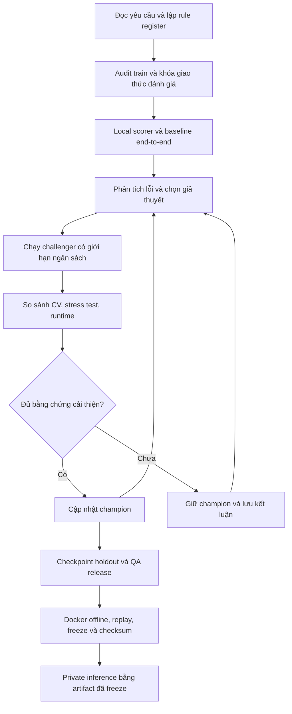

# Workflow thực nghiệm, mở rộng và kiểm định

Đây là quy trình đề xuất, chưa phải các bước đã triển khai. Dùng cùng `02_MASTER_PROMPT.md` và chọn nhiệm vụ cụ thể từ `04_STAGE_PROMPTS.md`.

## 1. Luồng công việc và điểm kiểm tra



Các điểm kiểm tra là tiêu chí kỹ thuật, không mặc định yêu cầu người dùng duyệt từng bước. Khi một điểm thất bại, sửa trong phạm vi được giao rồi đánh giá lại. Cần quyết định người dùng khi phát sinh chi phí, thiếu quyền, thiếu thông tin bắt buộc hoặc nộp/chia sẻ ra ngoài.

| Giai đoạn | Đầu ra cụ thể | Điều kiện để đi tiếp |
|---|---|---|
| BA | Brief, register yêu cầu/luật, risks và câu hỏi BTC | Mọi ràng buộc quan trọng có nguồn, giả định được đánh dấu |
| Audit/evaluation | Manifest, taxonomy, split, evaluator, test fixtures | ID/data integrity, matching và metric đã kiểm tra; holdout đã khóa |
| Baseline | Một lệnh predict/evaluate, JSONL, log, PA thật | Chạy đầu-cuối không dùng test để học; parser có provenance |
| Optimization | Experiment ledger, challenger/champion, ablation | Cải thiện có bằng chứng, không regression nghiêm trọng, còn runtime budget |
| QA | Báo cáo generalization, leakage, offline và reproducibility | Các mục bắt buộc có bằng chứng PASS; mục chưa kiểm tra không được xem là PASS |
| Freeze | Release image/config/model manifest, checksum và replay result | Đúng hướng dẫn BTC và tái lập từ cold start |
| Private | Output từ đúng release đã freeze và log | Không sửa giải pháp theo private, không can thiệp đáp án |

## 2. Cô đọng thông tin thành bộ nhớ có thể sử dụng

Không chỉ tóm tắt bằng văn xuôi. Lưu bốn lớp thông tin:

1. **Brief ngắn**: mục tiêu, metric, điều cấm, mốc nộp, tình trạng hiện tại; đọc đầu mỗi phiên.
2. **Register có cấu trúc**: luật, nguồn, điều kiện, precedence, ví dụ, module/test liên quan. Có thể dùng YAML; không để mô tả và code thành hai bộ luật lệch nhau.
3. **Bằng chứng thực nghiệm**: config, hash, dự đoán từng câu, errors, metric và runtime. Báo cáo chỉ trỏ về bằng chứng, không thay thế bằng chứng.
4. **State và decisions**: champion hiện tại, việc đang làm, lý do chọn/bỏ phương án, những gì chưa biết, bước tiếp theo.

Ví dụ record luật — đây là schema đề xuất, không phải file rule register đã tạo:

```yaml
rule_id: revenue.exclude_returned_order
source: train/rulebook.md
section: "1. Đơn hàng và doanh thu"
scope: revenue
condition: order_has_any_return
effect: exclude_entire_order
exceptions: []
implementation: semantics/revenue.py
tests: [partial_return_excludes_whole_order, late_return_status]
status: verified_from_document
```

Đường dẫn module/test trong ví dụ là mục tiêu tương lai. Khi runtime đọc split mới, tạo rule configuration và dấu vết nguồn từ **input hiện tại**, không lấy record train làm luật chung bất biến.

## 3. Thiết kế validation để phát hiện khả năng tổng quát hóa

### 3.1. Khóa split trước khi tối ưu

- Audit sâu dữ liệu train; dùng metadata/schema/README để nhóm business theo ngành, format và mức đầy đủ dữ liệu. Không giả định tên business là nhãn ngành.
- Đề xuất ban đầu: dành khoảng 6/30 business làm holdout, 24 business cho development. Đây là tỷ lệ khởi điểm, chỉ chốt sau audit phân bố nhóm và số mẫu; không phải yêu cầu BTC.
- Trên development dùng khoảng 4-fold Group CV theo business; cố gắng cân bằng type/độ khó. Với business gần trùng nguồn/template dữ liệu, cân nhắc đưa cùng nhóm để tránh validation quá dễ. Không chia câu paraphrase/synthetic cùng nguồn sang fold khác.
- Dùng thêm leave-one-business-type-out trên các nhóm đủ dữ liệu. Báo rõ ngành nào thực sự được giữ ngoài train, số business/câu và mức độ tin cậy. Không giả vờ kiểm chứng ngành hoàn toàn mới khi chỉ có một schema của cùng ngành.
- Mọi fold train có pipeline preprocessing/training/few-shot/template selection/calibration riêng. Profile schema của business validation tại inference là hợp lệ vì input mới chứa schema; fitting quyết định có dùng nhãn validation thì không còn hợp lệ.
- Nếu tập đánh giá trước đó đã được xem lỗi và dùng sửa, không gọi nó là blind holdout. Ghi exposure; giới hạn số lần mở holdout và checkpoint trước.
- Sau khi kết thúc model selection có thể refit trên toàn bộ train được phép. Không dùng score in-sample của bản refit làm bằng chứng tổng quát hóa. Calibrator phải dựa trên OOF theo chính sách đã chốt; kiểm tra tác động của refit tới confidence.

Temporal test là stress test bổ sung cho resolver/snapshot nếu phù hợp. Nó không thay thế business holdout trong bài toán có doanh nghiệp private mới; không cắt dữ liệu làm sai semantics của các câu train.

### 3.2. Test theo rủi ro, độc lập với answer test

Tạo fixture nhỏ với expected answer tính tay từ yêu cầu; hoặc synthetic độc lập từ **train-development**. Không dùng public/private làm nguồn sinh training hay test có nhãn.

| Nhóm kiểm thử | Điều cần phát hiện |
|---|---|
| Rulebook thay đổi | Đổi mặc định ranking, revenue, tuần… mà không sửa code; kết quả thay đúng luật mới |
| Thời gian | As-of giữa tháng, tháng ngắn, cuối năm, năm nhuận, tuần qua năm, Tết, ngày bao gồm/loại trừ |
| Status | Hủy, đang giao, trả một phần, trả sau as-of; doanh thu và nợ có mask khác nhau |
| Ingestion | Header nhiều dòng, merged cells, ngày thiếu năm, sheet theo tháng, file phân mảnh, encoding |
| Grain và join | Dòng hàng/đơn/phiếu; join 1:N làm nhân doanh thu; trùng dòng đúng phạm vi |
| Entity và units | Alias/không dấu/lỗi gõ, cùng tên khác mã, đơn vị nhiều cấp, hệ số từng hàng |
| Missingness | Thiếu thông tin, kỳ ngoài dữ liệu, kỳ giao một phần, không có giao dịch thật bằng 0 |
| Output | NFC, dấu tiếng Việt, percent, half-up khi luật yêu cầu, table/list, tie-break, strict JSON |
| Ngành/schema mới | Lược đồ khác và quy tắc ngành phát sinh từ tài liệu runtime |

Metamorphic test phải có giả định rõ: đổi tên cột cùng dictionary, đổi thứ tự dòng độc lập không đổi đáp án; thay as-of có thể đổi đáp án; thêm đơn hủy không đổi doanh thu nhưng có thể đổi tỉ lệ hủy. Không xáo các dòng trước khi parser khôi phục nhóm, hoặc giả định mọi phép thêm dữ liệu đều bảo toàn output.

### 3.3. Metric và quyết định champion

Mỗi run báo:

- N, correct C, wrong W, abstain A; `PA=(C−W)/N`, `coverage=(C+W)/N`, accuracy trên câu đã trả lời `C/(C+W)` nếu mẫu số >0; wrong/N.
- PA theo business, ngành, answer type, nhóm câu, format, temporal logic và độ đầy đủ README; số mẫu của mỗi slice.
- PA macro theo business và worst-group như chỉ báo rủi ro phụ; không thay metric chính thức.
- Risk–coverage và chính sách answer/unanswerable/abstain; chất lượng calibration trên OOF.
- Wall clock cold start, preprocessing/model loading, latency trung vị/p95, GPU memory theo từng GPU, RAM, lỗi/timeout và số câu đã ghi.
- Chênh score paired trên cùng câu; bootstrap chênh theo business để giữ cấu trúc phụ thuộc; số group nhỏ thì ghi CI không ổn định. Không dùng CI để khẳng định chắc chắn private.

Chọn candidate theo CV PA, độ bền qua nhóm/ngành, runtime và tính đơn giản. Đặt tiêu chí tối thiểu trước run lớn; mức cải thiện quá nhỏ/không ổn định phải ghi “chưa đủ bằng chứng”. Mọi lượt thử kể cả thất bại được lưu, vì chọn tốt nhất sau quá nhiều thử cũng overfit dev. Ngân sách đã định hết hoặc không cải thiện có ý nghĩa thì giữ champion.

## 4. Kiến trúc để mở rộng mà không hard-code doanh nghiệp

```text
Raw input + split rulebook/calendar + README
    -> generic readers + source provenance
    -> schema discovery + evidence-backed mapping + capability catalog
    -> rule interpretation + question plan + temporal/entity resolution
    -> deterministic SQL/Python execution over read-only data
    -> semantic/result checks + bounded repair
    -> calibrated decision: answer / unanswerable / abstain
    -> strict serializer + incremental output + structured logs
```

- Đơn vị mở rộng là reader, semantic operation, rule interpreter, planner hoặc verifier có contract; không phải một file giải riêng từng business ID.
- Canonical schema chỉ chứa phần dùng chung; có extension và đường về raw data cho ngành mới. Mapping phải kiểm tra keys, cardinality, unit/currency, coverage và confidence.
- Rulebook được đọc từ split input. Cache chỉ lưu metadata/mapping/kết quả tính trong run khi hợp lệ, key gồm hash dữ liệu, luật, calendar và config; không mang answer cache của test vào release.
- Truy xuất quy tắc liên quan kèm nguồn; test omission của retrieval nếu dùng retrieval thay vì toàn bộ rulebook.
- Model sinh plan có kiểu: output type, metric, filters, entities, time window, grouping, ranking, units, supporting rules và missing dependencies. Execution không tin rằng plan đúng chỉ vì schema hợp lệ.
- Kiểm tra đáp án bằng invariants và evidence khác với cùng một model lặp lại suy luận. Ensemble/model thứ hai chỉ thử khi tổng parameters và runtime cho phép; hai output đồng thuận không tự chứng minh đúng.
- Repair có giới hạn số vòng/thời gian, không retry vô hạn. Generated code chạy với filesystem/data/network restrictions và tài nguyên giới hạn.
- Logs ghi kế hoạch ngắn có cấu trúc, nguồn luật, code/SQL, kết quả thực thi, checks, quyết định, final answer và elapsed time; không yêu cầu lưu diễn giải suy nghĩ nội bộ dài.

## 5. Experiment ledger và cấu trúc repo đề xuất

```text
docs/
  competition/                 # Bộ prompt/workflow hiện tại
  PROJECT_STATE.md              # Trạng thái và handoff, tạo khi triển khai
  DECISIONS.md                  # Quyết định và bằng chứng
  requirements.yaml             # Requirement/rule register
  VALIDATION_PROTOCOL.md
configs/                       # Config versioned cho baseline/candidate
splits/                        # Manifest business/fold, seed, exposure policy
src/datamate/
  ingest/ schema/ semantics/ planning/ execution/ verification/
  confidence/ serialization/ evaluation/
tests/                         # Fixture nhỏ, expected tính độc lập
scripts/                       # Audit, evaluate, predict, replay, package
experiments/ledger.jsonl
runs/<run_id>/                 # Manifest, predictions, metrics, errors, logs
releases/<release_id>/          # Release manifest/checksum, QA report
predict.sh
Dockerfile
```

Ngoài `docs/competition/`, các đường dẫn trên là thiết kế tương lai, chưa được tạo bởi lượt soạn workflow này. Không commit raw data, weights, credentials hoặc runs lớn một cách mặc định.

Mỗi ledger record có tối thiểu: run_id, timestamp, hypothesis, baseline_run, change, code state/hash (Git commit nếu có), config hash, model revision/hash, input/rulebook/calendar hash, split hash, seed, train-data lineage, metric, runtime, artifacts, status và decision. Thay environment cũng là một thay đổi cần ghi.

Tính lặp lại: một command tạo run mới, không overwrite run cũ; evaluator tách khỏi inference; notebook chỉ dùng khám phá, logic chính nằm trong module/config. Khi lỗi mới được xác nhận trên train, thêm regression fixture đúng nguyên nhân rồi sửa module chung.

## 6. Ngân sách và lịch đề xuất

Trước training/GPU dài cần xác định máy, GPU/VRAM, thời gian/chi phí được phép, disk và khả năng Docker. Đề xuất mỗi batch experiment có tối đa số run, GPU-hours và timeout; chốt các giá trị khi có compute thực tế. Không để từ “tốt nhất” biến thành tìm kiếm không có điểm dừng.

Một thứ tự thực hiện hợp lý tính từ 26/10/2026:

| Khoảng đề xuất | Trọng tâm |
|---|---|
| 26–28/10 | BA, audit train, scorer, split, baseline CPU |
| 29/10–02/11 | Baseline model offline, ingestion/semantic coverage, CV |
| 03–09/11 | Sửa lỗi lớn, shortlist model, thử calibration/repair/fine-tune có chọn lọc |
| 10–13/11 | Kiểm định ngành mới, holdout checkpoint, ablation, benchmark cold start |
| 14–15/11 | Docker theo guideline, offline replay, QA và release candidate |
| 16/11 | Có buffer trước hạn 23:59; nộp khi người dùng chỉ định |
| 20–23/11 | Chạy đúng frozen release trên private, kiểm tra contract và nộp kết quả |

Deadline BTC trong brief là ràng buộc; lịch làm việc này chỉ là đề xuất và cần chỉnh theo tài nguyên. Nếu tiến độ chậm, ưu tiên pipeline chạy ổn và luật đúng trước kiến trúc phức tạp.

6 giờ / khoảng 500 câu tương đương 43,2 giây/câu nếu chạy tuần tự và chưa trừ overhead; đây chỉ là phép chia ngân sách, không phải timeout đảm bảo cho từng câu. Đặt mục tiêu nội bộ có dư địa, đo full-run vì batching, cold start và câu khó làm phép ngoại suy thiếu chính xác.

## 7. Checklist QA release

Mỗi dòng cần PASS/FAIL/NOT VERIFIED, evidence path, command, environment và người/phiên kiểm tra:

1. Đúng requirements, dùng rulebook/calendar từ `/data`; không fallback luật train một cách âm thầm.
2. Data lineage sạch: training/few-shot/templates/calibrator/synthetic không chứa test hoặc holdout ngoài giao thức; không có đáp án theo ID.
3. Scorer/format/aliases/ranking/rounding có fixture; các giả định chưa được BTC xác nhận được ghi rõ.
4. Có CV theo business, test ngành/schema/rulebook mới, holdout exposure log, errors và regressions.
5. Model inventory và source/licensing/date/parameter count hợp lệ; không còn model phụ bị quên.
6. Container mới chạy `predict.sh`, mạng tắt, `/data` read-only; không dùng file/cache ngoài artifact đã khai báo. Image chạy trên base guideline chính thức.
7. Toàn bộ private-like workload trong ≤6 giờ gồm model load; runtime trên máy không tương đương phải ghi chưa xác minh giới hạn BTC.
8. JSONL mỗi question ID đúng một lần, đúng type/schema, không NaN/Infinity, Unicode đúng; ID lạ/thiếu được phát hiện. Missing có thể abstain theo luật nhưng báo rõ lý do, không che mất failure.
9. Ghi output tăng dần hợp lệ và flush có kiểm soát; crash/timeout vẫn giữ dòng hoàn chỉnh; logs đủ ID, final answer, elapsed.
10. Chạy lại nhiều lần từ cold start, đối chiếu type/value từng câu và PA trên dữ liệu có nhãn. Mục tiêu nội bộ cùng output khi khả thi; ranh giới BTC là chênh PA ≤0,03. Không tính PA trên test không có nhãn.
11. Freeze code, configs, weights, tokenizer, dependencies, image digest/checksum. Kiểm tra deploy không tự tải model hoặc thay revision.
12. Có README, source training/inference, data/provenance theo hướng dẫn BTC, release manifest và lệnh replay; link Drive/checksum chỉ chuẩn bị hoặc công khai khi có lệnh người dùng.

Private input mới chỉ kích hoạt thuật toán runtime đã freeze để đọc schema/README/luật và tính kết quả. Không sửa prompt, code, thresholds, weights hoặc can thiệp tay theo private. Nếu có lỗi không thể xử lý bằng artifact đã freeze, ghi bằng chứng và xử lý theo hướng dẫn BTC.
